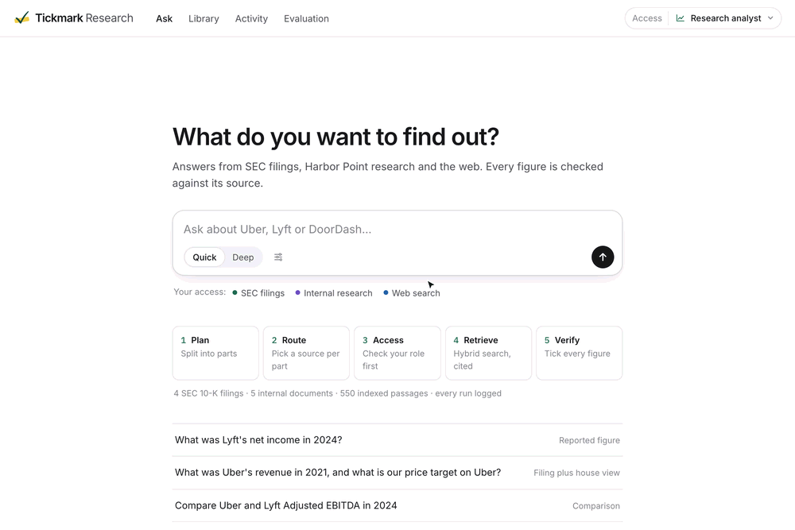
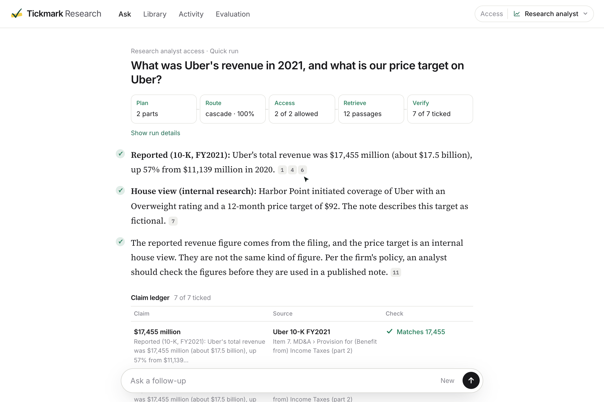
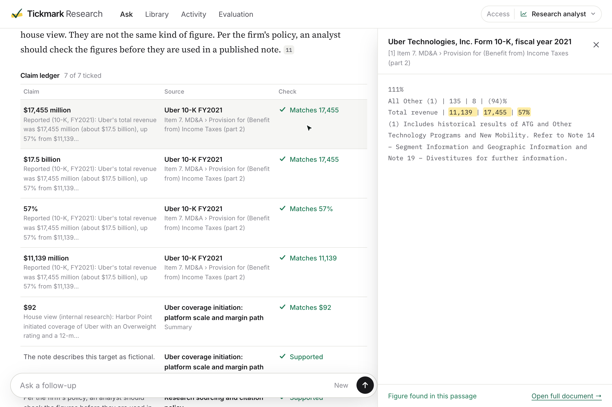
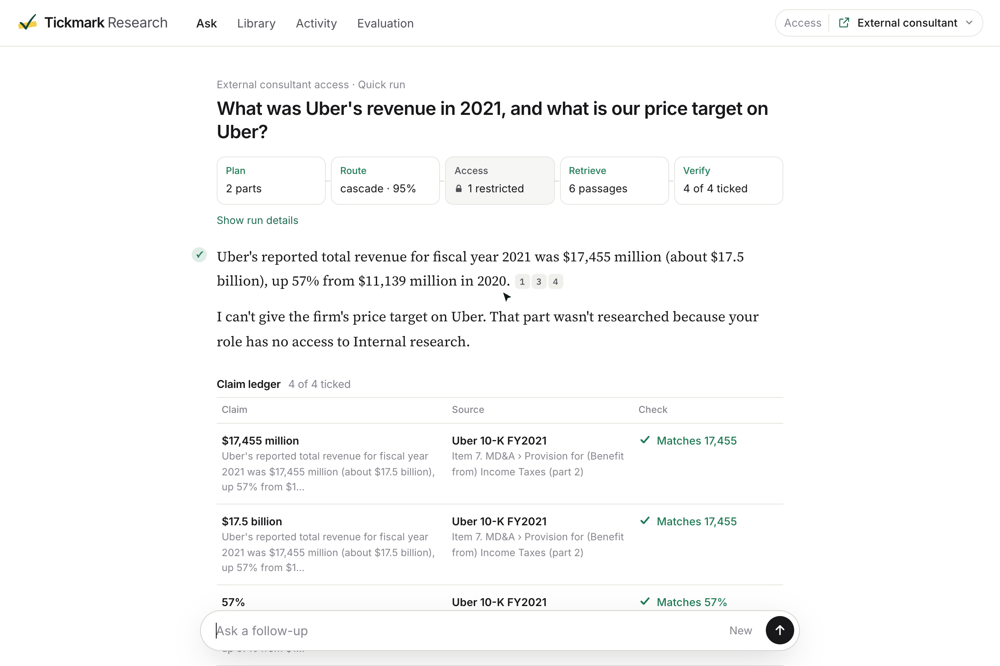
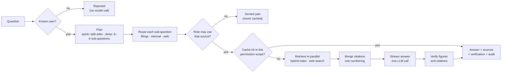
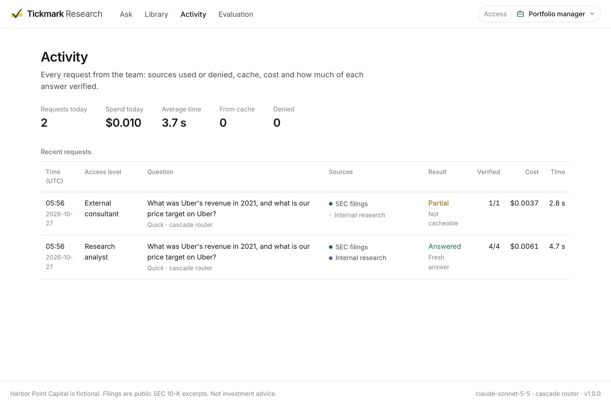

<p align="center"></p>
<h1 align="center">Tickmark Research</h1>

<p align="center"><b>Verified AI research for financial analysts</b><br>
Cited answers from SEC filings, internal research and the web. Every figure is checked against its source, and every source is checked against who is asking.</p>

<p align="center">
  <a href="https://github.com/J-A-Y-0/tickmark-financial-research/actions/workflows/ci.yml"></a>
  
  
  
  
  
</p>



<p align="center"><sub>Recorded with Claude Sonnet 5.5 and the Jev cascade router. The run sheet fills in stage by stage, every figure is ticked against the passage it came from, and the same question from an external consultant stops at the access stage.</sub></p>

## The business case

**The problem.** Analysts at an investment firm spend their day cross-checking three kinds of source: company filings, the firm's own research, and the news. General-purpose chat assistants are fast at this but unusable in a regulated team:

- **They can't be trusted.** A number with no source, or a citation that does not say what the sentence claims, is worse than no answer.
- **They don't know who is asking.** Deal memos and house views must not reach an outside consultant, and a shared cache must not leak a portfolio manager's answer to an analyst.
- **Their cost is unmanaged.** Running deep, multi-step research on a one-line lookup burns budget and time.

**What Tickmark does.** It splits a question into the parts that need different sources, routes each part to SEC filings, internal research or the web, checks the user's permissions before anything is retrieved, streams an answer with numbered citations, and then checks every figure and citation in that answer against the passages it cites.

**What success looks like.**
- Zero restricted content reaching a user without access, including through the cache. This is enforced in code and covered by tests.
- Every figure in an answer traceable to a cited passage, and the ones that aren't flagged on screen.
- Cheap by default: quick answers use one generation call, and deep research is opt-in with a cost estimate and a daily cap.

## Not a chat window: every answer is a run sheet

A tick mark is what an auditor pencils next to a figure once it has been agreed to its source. Tickmark gives every answer the same treatment, and the screen shows the system that produced it rather than just the text:

- **Pipeline strip.** Plan, route, access, retrieve and verify, each with its real result for this run: how many parts, which router and how sure it was, what your role was allowed to search, how many passages came back, and how many claims were ticked.
- **Ticks in the margin.** Each paragraph whose claims verified gets a tick; anything that didn't gets a flag.
- **Claim ledger.** Every figure in the answer becomes a row: the claim, the source and locator it rests on, and the check ("Matches 17,455"). Clicking a row opens the passage with the figure highlighted.
- **Run receipt.** Model, router, time, cost, cache outcome and the audit-log request ID.

| The run sheet | The claim ledger and source |
| --- | --- |
|  |  |

The AI writes; the system decides what it may read and checks what it wrote. When a question needs a source the user's role can't access, the run stops at the access stage and says so:



## Not all AI: who does what

| Job | Who does it | Why |
| --- | --- | --- |
| Split a question into sub-questions; write the answer | **LLM** | Language understanding and synthesis |
| Decide which source answers each sub-question | **Router** (LLM, TypeSafe Jev, or a cascade) | Swappable and measured; see [evaluation](#evaluation) |
| Decide what the user may see | **Code** | Default-deny policy applied before retrieval; a router cannot grant access |
| Find passages; narrow to the company and fiscal year asked about | **Code** | Hybrid BM25 + vector search with metadata filters |
| Merge citations across sub-questions into one numbering | **Code** | Deterministic de-duplication |
| Check figures and citations in the answer | **Code** (+ optional Jev) | "$17.5 billion" must match "17,455" in a millions table, or it is flagged |
| Cache, spend caps, audit log | **Code** | Partitioned by permission scope; every request recorded |



## How it works

**Planning, quick and deep.** Quick mode splits only what the user asked: one question stays one, and "Uber's 2021 revenue *and* our price target" becomes two. Deep mode plans three to six sub-questions covering facts, drivers and open risks. A malformed plan never crashes a request; it falls back to the original question and says so in the trace. ([`tickmark/planning.py`](tickmark/planning.py))

**Four interchangeable routers.** They sit behind one interface and share one description of the sources ([`tickmark/routing.py`](tickmark/routing.py)):

| Router | How it decides | Why it exists |
| --- | --- | --- |
| `keyword` | Deterministic rules | Free, instant, offline baseline |
| `llm` | A small chat model returns JSON with a reason | Strong on ambiguous wording |
| `jev` | One TypeSafe Jev `Choice` with calibrated probabilities | Roughly $0.00002 per decision at list price (≈400 input tokens; output is free) |
| `cascade` | Jev first; the LLM only when Jev's confidence is below 0.8 | Aims for LLM accuracy at Jev cost, to be confirmed by evaluation |

Every router treats the question as data, not instructions. That matters less than it seems, because routing never grants access (see below).

**One generation call, one citation numbering.** Sub-questions are retrieved in parallel, their passages are merged into one numbered source list (duplicates collapsed, each tagged with the sub-question that found it), and a single model call writes the answer. This saves N−1 calls compared with answering each part and then combining the answers, and it starts streaming sooner. ([`tickmark/synthesis.py`](tickmark/synthesis.py))

**Verification on every answer.** ([`tickmark/verify.py`](tickmark/verify.py)) Each sentence of the answer is checked:

- **Citations.** `[n]` must refer to a passage that was actually retrieved; otherwise the sentence is marked `fabricated`.
- **Figures.** Each figure must appear in a cited passage, allowing for units and rounding. "$17.5 billion" matches a table cell of `17,455` under "(In millions)"; "$19.1 billion" does not, and is flagged.
- **Support.** The claim's words must overlap its sources. Optionally, Jev judges support semantically, following TypeSafe's [citation-check pattern](https://docs.typesafe.ai/cookbooks/citation_check.md).
- **Uncited figures.** A sentence that states a figure is flagged as `uncited` unless the figure appears in a source cited by that sentence or by the sentence right next to it in the same paragraph. Sentences that only label provenance ("This is a reported figure") are not treated as claims.

Flags are shown in the margin and in the claim ledger; nothing is silently rewritten. Every citation and every ledger row opens the passage the answer read, with the matching figure highlighted.

## Access control and the cache

Access control has two layers, both default-deny ([`tickmark/access.py`](tickmark/access.py), [`data/access.json`](data/access.json)):

| Role | SEC filings | Internal research | Web | Restricted deal memos |
| --- | :-: | :-: | :-: | :-: |
| Portfolio manager | ✓ | ✓ | ✓ | ✓ |
| Research analyst | ✓ | ✓ | ✓ | – |
| External consultant | ✓ | – | ✓ | – |

1. **Route permission.** Checked after routing and before any retrieval or cache lookup. Unknown users are rejected before any model call.
2. **Document permission.** Applied inside retrieval: a chunk the role cannot read is never scored, so it can never reach a prompt, a citation or the cache.

The semantic cache ([`tickmark/cache.py`](tickmark/cache.py)) is partitioned by **policy version + role + allowed sources + index version**:

- An answer cached for a portfolio manager can never be served to an analyst, even for the identical question.
- Changing the policy, uploading a document or rebuilding the index makes older entries unreachable instead of stale.
- When a user's role changes, their next request reads the new role's partition. Nothing cached under the old role is reachable through the new one.
- Denials, partial answers, answers with fabricated citations and time-sensitive questions ("latest", "today", a current year) are never stored.

Every request lands in an audit log: who asked, which sources were routed, allowed or denied, the cache outcome, cost, latency and the verification summary. Portfolio managers see everyone's activity; everyone else sees their own.



## Retrieval engineering

Most answer quality is decided before the model sees anything ([`tickmark/retrieval/`](tickmark/retrieval/)):

- **Hybrid search.** SQLite FTS5 (BM25, Porter stemming) and vector similarity, fused with reciprocal rank fusion. No external vector database: one SQLite file, rebuilt offline in about a second.
- **Metadata scoping.** "Uber revenue in 2021" searches only Uber's FY2021 10-K. "Uber free cash flow in 2023" falls back to the FY2024 filing, whose comparative columns contain 2023.
- **Comparisons.** "Uber vs Lyft" searches each company separately and interleaves the results, so the company with more matching text cannot crowd the other out.
- **Tables keep their headers.** 10-K tables often put `2024 | 2023 | % Change` and "(in millions)" above a sub-heading. The chunker carries them into the continuation rows, so a retrieved row still says which column is which year.
- **Contextual chunk headers.** Each chunk is indexed with its company, fiscal year and section (`Item 7. MD&A › Results of Operations`), and that locator is what the citation shows.
- **Uploads are processed off the request path.** An upload returns `202` immediately and moves through pending, parsing, embedding and indexed. It becomes `indexed` only after a read-back check finds the new chunks.

The corpus is real and reproducible: Item 1 and Item 7 of four 10-Ks (Uber FY2021 and FY2024, Lyft FY2024, DoorDash FY2024) pulled from SEC EDGAR by [`data/build_filings.py`](data/build_filings.py). Each file records its accession number and source SHA-256, and a re-run reproduces it byte for byte. The internal research belongs to a fictional firm, Harbor Point Capital, and is labelled as such ([`data/knowledge/`](data/knowledge/)).

## Evaluation

[`evals/`](evals/) compares routers under identical conditions:

- **Same inputs for every router.** The sub-questions come from the case file, so planner variance is removed. Sources, answer model and scoring rules are identical, and the cache is off.
- **Pre-registered.** Expected routes and answers are written before any run, and each report records the case file's SHA-256.
- **39 cases** across seven categories:
  - single-source questions for each of the three sources (filings 10, internal 6, web 4);
  - multi-part questions that span sources (6);
  - ambiguous questions with more than one acceptable route (4);
  - prompt injection against the router or the access check (5);
  - access control, including a cached answer that must not cross roles (4).
- **Four dimensions, reported separately:**
  - accuracy (route accuracy per sub-question, and answer correctness by numeric figure matching within 1%);
  - safety (no leaked text, no forbidden source, the expected denial);
  - speed (routing and end-to-end p50/p95);
  - cost (routing and total, from token counts and [list prices](tickmark/llm/pricing.py)).

### Results

Run [`20261027-003340`](evals/results/20261027-003340.md): 39 cases × 4 routers, answer model `claude-sonnet-5-5`, planner and LLM router `claude-haiku-5-5`, Jev `jev-1.14.0`, hashing embeddings, **no web-search key configured**. The whole run cost **$0.97** for 156 answered requests.

| Router | Route accuracy | Answer accuracy | …without web cases | Safety | Grounding | Route p50 | End-to-end p50 | Route $/case | Total $/case |
| --- | --- | --- | --- | --- | --- | --- | --- | --- | --- |
| `keyword` | 98% | 77%¹ | 93% | 100% | 90% | 0 ms | 2.6 s | $0 | $0.0065 |
| `llm` | **100%** | 77% | 93% | 100% | 91% | 980 ms | 3.3 s | $0.00010 | $0.0064 |
| `jev` | 96% | 71% | 86% | 78%² | 89% | **127 ms** | 2.5 s | **$0.00003** | $0.0057 |
| **`cascade`** | **100%** | 77% | 93% | **100%** | 91% | 162 ms | 2.7 s | $0.00004 | $0.0062 |

<sub>"Without web cases" excludes the 6 cases that need web search, which no router could answer without a search key. ¹ The run scored keyword at 80%; it credited W03, which keyword answered from internal research instead of the web. The scoring rule now requires a web source for web cases (`evals/scoring.py`), which gives 27/35 = 77%. ² Jev sent "What are the proposed terms of Project Atlas?" to the web in both access cases; no restricted content leaked in any of the 156 runs.</sub>

**What the numbers say**

- **Ship the cascade.** It matched the LLM router's 100% route accuracy with one-sixth of its routing latency (162 ms vs 980 ms p50) at about 40% of the routing cost. Jev decides alone when it is confident and hands uncertain questions to the LLM; that hand-off is the slow tail (route p95 1.6 s). It covered both Project Atlas questions, where Jev on its own guessed wrong.
- **Jev alone is the fastest and cheapest router, and its misses are specific.** A deal name ("Project Atlas") isn't in the source descriptions, so Jev guessed web. The cascade catches exactly these low-confidence cases. That is the argument for using confidence instead of trusting a single label.
- **Routing is not the bottleneck; retrieval is.** The same two cases fail for every router: Lyft's 2024 rides (F06) and Lyft's Adjusted EBITDA in a comparison (M04). In both, the passage holding the expected figure (828.3 million rides; $382.4 million) never reaches the top six retrieved passages: it sits in a key-metrics table that the offline hashing embeddings rank too low. The next improvement is semantic embeddings plus table-aware retrieval, not a better router.
- **Routing is under 1% of the cost.** All routing across the run cost $0.006; the answer model is the rest. Router choice is a latency and accuracy decision, not a cost one.

```sh
make eval                                    # every configured router
python -m evals.run --routers llm,jev,cascade
```

Methodology and scoring rules: [docs/evaluation.md](docs/evaluation.md). Every number above comes from the run file in `evals/results/`, which also records the SHA-256 of the case file it ran against.

## Production engineering

- **Streaming with visible steps.** Server-Sent Events emit, in order: plan → routes → access decisions → cache → searches → sources → answer tokens → verification → done. Sources arrive before the first token.
- **Graceful degradation.**
  - A failed planner or router falls back to the original question or to keyword routing, and the trace says so.
  - A failed search is shown on screen and marks the answer `partial`.
  - A failed answer model returns an error, never an answer that looks complete.
  - A second search provider can take over when the first fails.
- **Bounded cost and time.**
  - Per-request time limits (90 s quick, 240 s deep) end with an honest partial answer.
  - Each user has a daily budget and a deep-research cap.
  - Deep mode shows a cost estimate before it runs.
  - Every response reports its tokens, dollars and per-stage latency.
- **Safe rendering.** Source text from the web and from uploads is escaped before any formatting, and redirects after sign-in are restricted to local paths.

## Quick start

Runs offline in about a minute, with no accounts or API keys:

```sh
git clone https://github.com/J-A-Y-0/tickmark-financial-research.git
cd tickmark-financial-research
make install
make demo
```

Open <http://localhost:8000> and switch the access level in the top-right corner: portfolio manager, research analyst or external consultant.

Offline mode uses a rule-based planner, the keyword router and an extractive writer that quotes the best passages instead of synthesizing. Planning, routing, access control, retrieval, citations, verification, caching and the audit log are all real. To use real models, copy `.env.example` to `.env`, then set:

- `LLM_PROVIDER=openai` (or `anthropic`) and its API key;
- `EMBEDDING_PROVIDER=openai` for semantic search;
- `TYPESAFE_API_KEY` to enable the Jev and cascade routers;
- `SEARCH_PROVIDER=tavily` (or `serpapi`) and its key for web search.

Then run `make run`.

From the command line:

```sh
.venv/bin/python -m tickmark ask "What was Lyft's net income in 2024 and what is our rating on Lyft?" --role consultant
.venv/bin/python -m tickmark ask "Should we stay Overweight on Uber?" --deep --router cascade
```

Deployment (Render or Docker): [docs/deployment.md](docs/deployment.md).

## Testing

```sh
make test   # 142 tests, offline, about 1 second
make lint   # ruff check + format
```

The tests use scripted models and cover:

- planning and its malformed-output fallbacks;
- all four routers, including Jev confidence handling and cascade escalation;
- figure matching across units and rounding;
- hybrid retrieval, metadata scoping and comparisons;
- document permissions and uploads (Markdown, text and PDF) with the read-back check;
- the cache rules: hits, misses, cross-role isolation, denials never cached, time-sensitive bypass, invalidation on policy change, upload or role change;
- event order, the single generation call, failure paths and spend caps;
- the web app and its permissions;
- the evaluation scoring.

## Tech stack

Python 3.12 · FastAPI · Server-Sent Events · SQLite (FTS5) + NumPy vectors · OpenAI / Anthropic · TypeSafe Jev · Tavily / SerpApi · pypdf · server-rendered HTML with vanilla JS (no build step) · Docker / Render · GitHub Actions

## Project structure

```text
tickmark/
  engine.py        the pipeline, emitted as a stream of events
  planning.py      quick and deep planning with fallbacks
  routing.py       keyword, LLM, Jev and cascade routers
  access.py        role and document permissions
  cache.py         semantic answer cache, partitioned by permission scope
  sources.py       filings, internal and web adapters; web cache and fallback
  synthesis.py     prompt, LLM writer, offline extractive writer, citation merging
  verify.py        figure and citation verification
  audit.py         audit log and spend controls
  retrieval/       chunking, embeddings, hybrid store, ingestion
  llm/             provider adapters and list prices
web/               FastAPI app, templates, static assets
evals/             cases, scoring, runner, results
data/              10-K excerpts (+ builder), synthetic internal research, access policy
tests/             unit, integration and web tests
docs/              architecture, security, evaluation, deployment
```

## Limitations and next steps

- **Small corpus.** Four 10-K excerpts (Items 1 and 7) cover the demo. A real deployment would ingest full filings, 10-Qs and transcripts, with XBRL figures as a structured source.
- **Demo identity.** Users are a cookie naming a policy entry. Production needs SSO, with roles taken from identity-provider claims.
- **Lexical offline embeddings.** Hashing embeddings are lexical rather than semantic, so semantic search and the semantic cache need `EMBEDDING_PROVIDER=openai`.
- **No follow-up memory.** Each question is answered independently; there are no conversation threads or long-term memory.
- **Flags, not fixes.** Verification marks unsupported sentences but doesn't rewrite them. A strict mode that holds the answer until it verifies is a natural next step.
- **Single process.** SQLite and an in-process upload worker suit one instance. Scaling out means Postgres with pgvector and a job queue.
- **Next:** semantic embeddings and table-aware retrieval (the two failures every router shared), a web-search key so the web cases can be scored, an XBRL source for exact figures, and a pilot with an analyst team to measure time-to-answer.

## Background

Tickmark started as LUMINA, a team project (Lumina Group 5) in UCLA Anderson's MSBA course *MGMTMSA 440: Building LLM Applications*, Fall 2026. Two course exercises inspired it:

- a Perplexity-style answer engine ([public spec](https://github.com/hamzafarooq/multi-agent-course/tree/main/modules/Module_1_Agent_Foundations_Harness_System_Design/Assignment_1_Lumina));
- an agentic RAG router comparison using TypeSafe Jev.

This repository is my independent rebuild and redesign, oriented around a financial-research use case and renamed for what it does. It contains no code from the course starter kit or from the group's submission. SEC filings are public records; Harbor Point Capital and all of its documents are fictional, and nothing here is investment advice.
