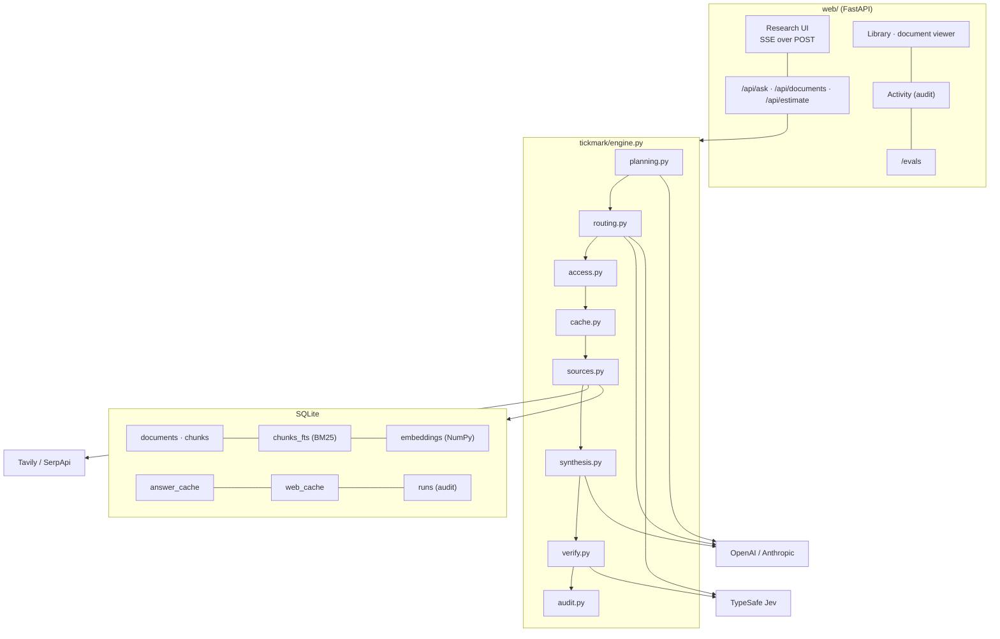

# Architecture

Tickmark is one Python process: a FastAPI app over a pipeline (`tickmark/engine.py`) that
emits a stream of events. One SQLite file holds the search index, the caches and the
audit log.

## Request lifecycle

| Step | Module | Event(s) | Notes |
| --- | --- | --- | --- |
| Identify | `access.py` | `error` (unknown user) | Before any model call, search or cache lookup |
| Spend gate | `audit.py` | `error` (budget, deep cap) | Daily per-user budget; deep-research cap |
| Plan | `planning.py` | `plan` | LLM or heuristic; malformed output falls back to the original question |
| Route | `routing.py` | `route` | Sub-questions routed in parallel; each decision carries its router, reason, confidence, latency and cost |
| Access check | `access.py` | `denied` | Default-deny per role and source |
| Cache | `cache.py` | `cache` | HIT / MISS / BYPASS, inside the caller's permission scope |
| Retrieve | `sources.py`, `retrieval/` | `trace` | Parallel; each search reports results, latency, provider, cache and errors |
| Merge | `synthesis.py` | `sources` | One citation numbering, de-duplicated by URL or document + locator |
| Generate | `synthesis.py` | `token` | One model call for all sub-questions |
| Verify | `verify.py` | `verification` | Per-sentence verdicts and a summary |
| Record | `audit.py` | `done` | Status, cache outcome, usage, cost, per-stage timings |

## Key decisions

**One generation call for multi-part questions.** The answer model sees every
sub-question with its own sources in one prompt. Compared with answering each
sub-question and then merging the answers, this saves N−1 calls and the combining step.
It also streams sooner, and it lets the model connect parts ("revenue grew 18% while our
estimate assumes 15%"). The cost is a larger prompt, which is capped at 1,800 characters
per source.

**Route first, then check access.** The router decides where an answer lives; it is
never asked what the user may see. Restricting the router's options to permitted sources
would silently send a consultant's internal-research question to the web and return a
worse answer with no explanation. Routing first and denying explicitly tells the user why
and records the denial. A router that is talked into a restricted source by a prompt
injection still ends in a denial.

**SQLite instead of a vector database.** About 550 chunks fit comfortably in memory, so
a NumPy matrix product is exact and takes well under a millisecond, and FTS5 provides
BM25. One file keeps the demo and the tests self-contained. The `DocumentStore`
interface (`search`, `add_chunks`, `probe`) is the seam for moving to Postgres with
pgvector.

**Flags, not rewrites.** Verification is deterministic and cheap, so it runs on every
answer. Rewriting a flagged sentence would need another model call and could introduce
new errors. Showing the flag lets the analyst decide, as the research policy in the demo
corpus requires.

**Offline mode is real, not mocked.** The heuristic planner, keyword router, hashing
embeddings and extractive writer are production code paths. They let anyone run the
whole system without keys, and they let the tests exercise the real pipeline.
